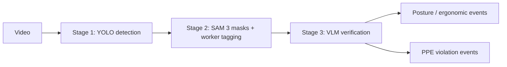

# CAGE — Construction Site Safety Intelligence

[](https://python.org)
[](https://fastapi.tiangolo.com)
[](https://nextjs.org)
[](https://bun.sh)
[](https://ultralytics.com)
[](https://ai.meta.com/sam3/)
[](https://api.meta.ai)
[](https://docs.pytest.org)
<html>

<a href="https://deepwiki.com/moah0911/cage"></a>
</html>
ML-powered end-of-day safety reporting for construction sites. POV
body-worn footage and fixed wall cameras feed one pipeline that flags PPE
violations, posture/ergonomic risk, and OSHA hazards, then produces a
per-worker report — no real-time human review required.

Built for the [Meta AI Developer Hackathon](https://cerebralvalley.ai/e/meta-ai-developer-hackathon):
segmentation runs on **SAM 3.1** and Stage-3 verification + shift briefs
run on Meta's hosted models via the **Meta Model API** (`api.meta.ai`).
See [docs/META_INTEGRATIONS.md](docs/META_INTEGRATIONS.md).

## Why

In 2023, U.S. construction saw ~1,075 fatal injuries (9.6 per 100,000 FTE)
— the most of any industry. Fall protection is OSHA's most-cited violation
year after year, and most incidents are preventable. No affordable,
passive, continuous monitoring system watches multiple workers, resolves
identities over time, and produces an actionable report. CAGE is that
end-of-shift system, practical on commodity hardware.

## Pipeline (shared by posture + PPE)



| Stage | Component | Output |
|---|---|---|
| 1 | Fine-tuned YOLO (+ pose model, BoT-SORT) | Boxes, labels, violation candidates |
| 2 | Meta SAM 3.1 API (`SAM_BACKEND=meta`) or local SAM 3 | Refined masks/boxes, worker track IDs |
| 3 | Qwen3-VL locally **or Llama 4 via Meta Model API** | Compliance-checked `VLMAssessment` |

Stage 3 locally runs a 3-pass adversarial chain (Observer → Auditor →
Reconciler) with confidence calibration; via the API it is a single
reconciler-style pass over annotated frames. Workers are held across
occlusions by an appearance-embedding registry (embeddings stay local;
only opaque worker codes ever reach the API).

Code: `backend/app/pipeline/wall_cam.py`, `posture.py`, `vlm_step.py`;
Meta client in `backend/app/integrations/meta_llama.py`.

## Quickstart

Prerequisites: Python 3.10+, [Bun](https://bun.sh). GPU only needed for
local models / `VLM_BACKEND=local`.

```bash
# Terminal 1 — backend
cd backend
bash setup.sh                       # venv + deps + .env (first time)
# paste your key into backend/.env:  MODEL_API_KEY=...
source venv/bin/activate
uvicorn app.main:app --host 0.0.0.0 --port 8000
# check: GET http://localhost:8000/health  and  /meta/status

# Terminal 2 — frontend
cd frontend
cp .env.example .env.local          # first time only
bun dev                             # http://localhost:3000
```

Model weights (not committed, gitignored) go in `backend/models/`:
`last.pt` (YOLO PPE — already restored from git history), `sam3.pt`,
plus `qwen3-vl/` + `yolo26l-pose.pt` for local mode, or skip local
weights entirely with `SAM_BACKEND=meta` + `VLM_BACKEND=meta`. Without a
Meta key the API still boots; Meta endpoints return `503` until
`MODEL_API_KEY` is set. Full data guide: [docs/DATA.md](docs/DATA.md).

## Structure

```
backend/app/     FastAPI: core/config (all env), db, models, schemas,
                 api/routes (health, meta, sites, devices, workers,
                 shifts, events, process, jobs, reports),
                 services/jobs, integrations (Meta Model API),
                 pipeline (wall_cam, posture, vlm_step)
backend/tests/   pytest — no GPU, weights, or keys needed
frontend/        Next.js dashboard (app/, lib/api.ts)
docs/            Meta integration map
notebooks/ scripts/   Exploratory work (see their READMEs)
assets/results/  Curated example outputs
```

Full contracts: [PROJECT_REQUIREMENTS.md](PROJECT_REQUIREMENTS.md) ·
[backend/README.md](backend/README.md)

## API (FastAPI :8000)

`GET /health` · `GET /meta/status` · `GET /meta/models` · `POST /meta/segment` · `POST/GET /sites`
· `POST/GET /devices` · `POST /workers/register|checkin`, `GET /workers`
· `GET/PATCH /shifts/{id}` · `POST /events/ingest`, `GET /events`
· `POST /process/pov|wall-cam` · `GET /jobs`, `/jobs/{id}`,
`/jobs/{id}/results|vlm|frames/{f}` · `GET /reports/shifts/{id}/summary`

## OSHA coverage

Fall protection (1926.501/503), scaffolding (1926.451), eye/face PPE
(1926.102), machine guarding proximity (1910.212), ladder safety,
respiratory PPE, and POV ergonomic/MSD risk — scored by severity and
frequency; repeat violations surface first in the report.

## Results

| Compliant | Violation |
|---|---|
|  |  |
|  |  |

Dashboard per worker: violation + compliant logs with clip previews,
ergonomic risk score, camera-coverage hours, and an AI shift brief.

## Data

Training/reference: Ultralytics Construction-PPE, SH17, Roboflow/Kaggle
PPE sets; CWPV working-postures videos; Önal & Dandıl safe/unsafe
behaviour videos; OSHA Top Violations 2024. Hours of POV site footage
were processed for tuning; footage and derived clips are gitignored and
never committed.

## Privacy & secrets

No credentials are committed — `.env` files are gitignored and every
`.env.example` ships empty. Worker display names and embeddings never
leave the local DB; Meta API calls carry only anonymized worker codes.
VLM review roles (Observer/Auditor/Reconciler) are anonymous.

## Limitations

Wall-cam re-ID/object permanence is partial (tracker persistence works,
embedding re-association is open); PPE false positives under variable
lighting; posture thresholds are sensitive at the good/borderline edge;
POV signal drops when the lens is obstructed.
